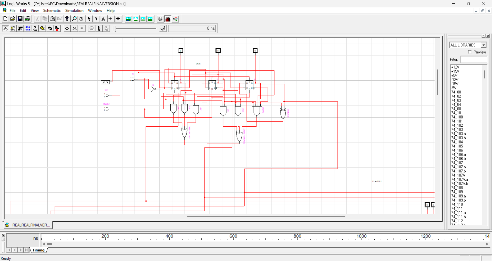
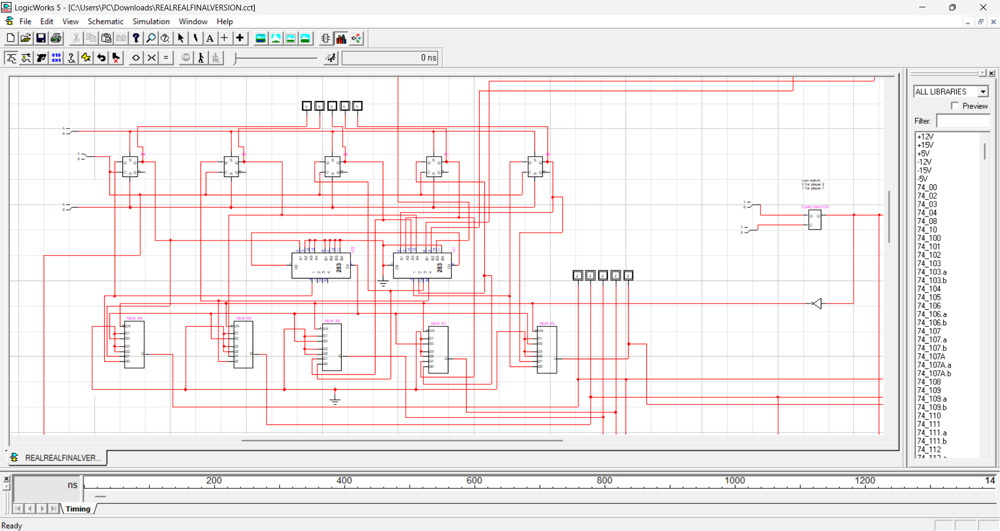
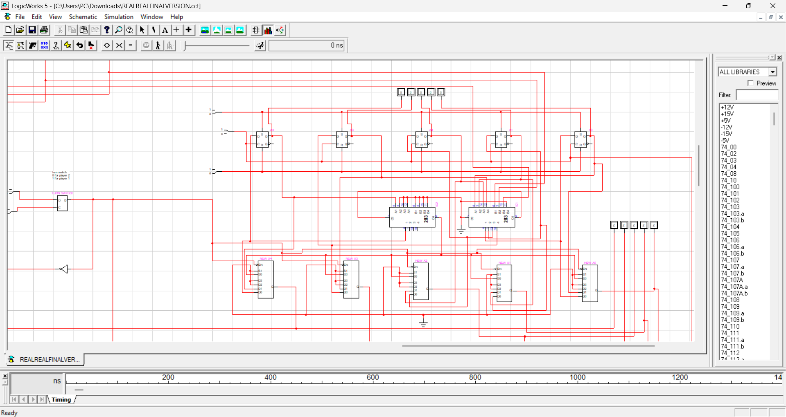
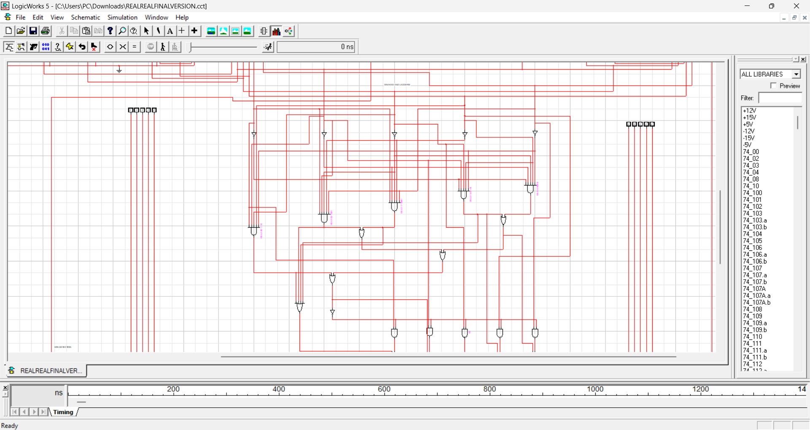
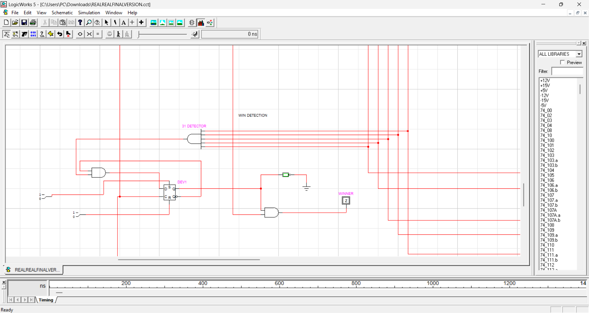

# Snakes and Ladders: Digital Logic Circuit

A fully working **two-player Snakes and Ladders game built entirely from digital logic** and simulated in **LogicWorks 5**. It was my Digital Logic Design (DLD) project at FAST-NUCES, Lahore.

Players take turns rolling a dice (1 to 6) and moving across a 32-cell board (cells 0 to 31). The first player to reach cell 31 wins.

## Game rules

- Two players, alternating turns
- Dice values from 1 to 6
- **Ladders:** 2 → 9, 14 → 27
- **Snakes:** 17 → 8, 25 → 16, 30 → 0
- **Overshoot protection:** if a roll would take a player past cell 31, they stay where they are
- **Winner detection:** the circuit detects cell 31 and outputs which player won
- **Reset:** returns the game to its starting state

## Inputs and outputs

| Signal | Type | Description |
|---|---|---|
| Clock Pulse (CP) | Input | Master clock for all sequential elements |
| Start Dice Roll | Input | 1 = dice running, 0 = stop |
| Reset | Input | Returns both players to cell 0 |
| Player 1 / Player 2 Position | Output | 5-bit binary value (0 to 31) shown on LEDs |
| Winner Player (WP) | Output | 0 = Player 1 won, 1 = Player 2 won |

## How it works

The circuit is split into eight blocks:

1. **Position registers:** five D flip-flops per player store the current cell.
2. **Turn select multiplexer:** a turn flip-flop chooses whose position goes forward.
3. **Dice roll unit:** a 3-bit counter running on the clock, mapped to values 1 to 6.
4. **Adder:** 74283 4-bit adders add the current position and the dice value.
5. **Overshoot protection:** a comparator and multiplexer keep the player in place if the sum is over 31.
6. **Snake and ladder mapper:** AND/OR/NOT gate logic detects the head cells (2, 14, 17, 25, 30) and replaces them with the tail cell.
7. **Winner detector:** a 31 detector and a latch flip-flop record the win and stop further play.
8. **Control logic:** toggles the turn and enables the game while it is active.

The full technical write-up, with gate equations, truth tables and test cases, is in [`docs/Snakes_and_Ladders_Technical_Documentation.docx`](docs/Snakes_and_Ladders_Technical_Documentation.docx).

### Snake and ladder mapping

| Head | Type | Tail |
|---|---|---|
| 2 | Ladder | 9 |
| 14 | Ladder | 27 |
| 17 | Snake | 8 |
| 25 | Snake | 16 |
| 30 | Snake | 0 |

## Screenshots

**Dice roll unit**

**Adders and position registers**

**Datapath overview**

**Snakes and ladders mapper**

**Win detection**

## Concepts used

- Sequential design with D flip-flops and counters
- Multiplexers and 4-bit binary adders
- Combinational logic built from basic gates
- Magnitude comparison and overshoot handling
- Finite game-state control (turns, win latch, reset)
- Simulation and verification in LogicWorks 5

## How to run

1. Install **LogicWorks 5**.
2. Download this repository.
3. Open `REALREALFINALVERSION.cct` in LogicWorks 5.
4. Press Reset, then use the Start Dice Roll switch and clock to play a turn. Watch the position LEDs and the Winner output.

## Author

**Aleezay Salman**
BS Computer Science, FAST-NUCES Lahore
[github.com/l250558-byte](https://github.com/l250558-byte)
